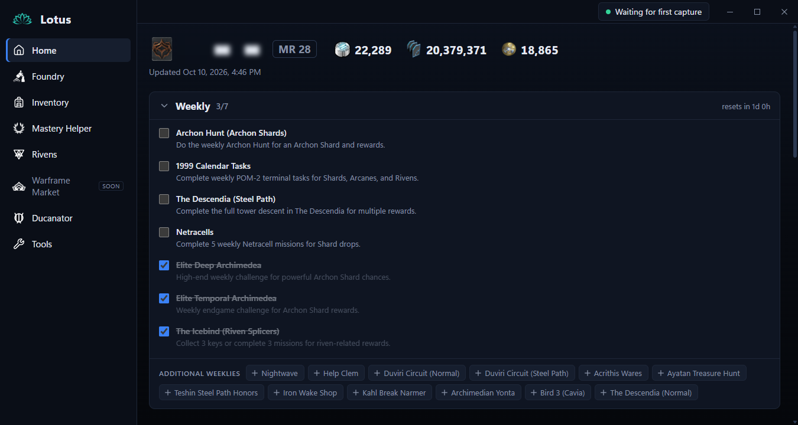
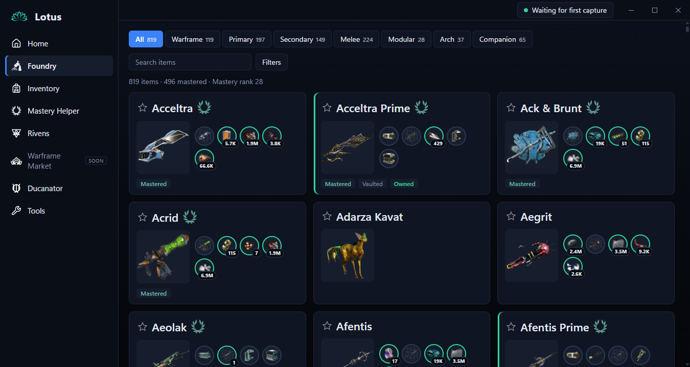
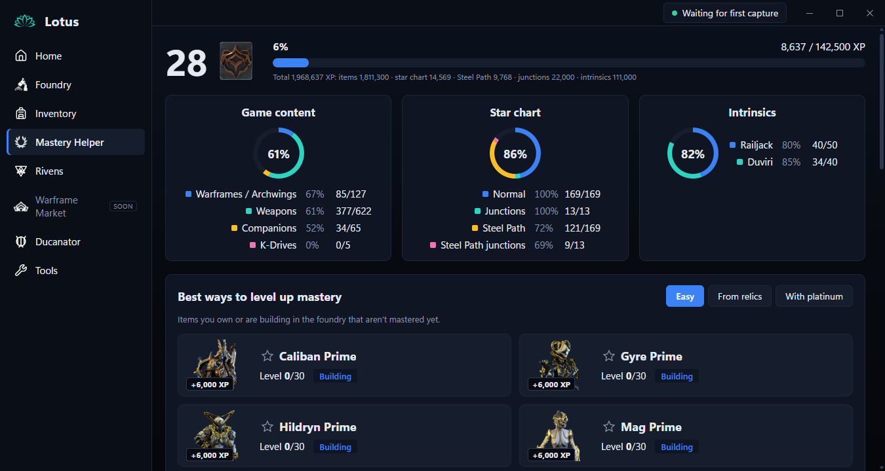
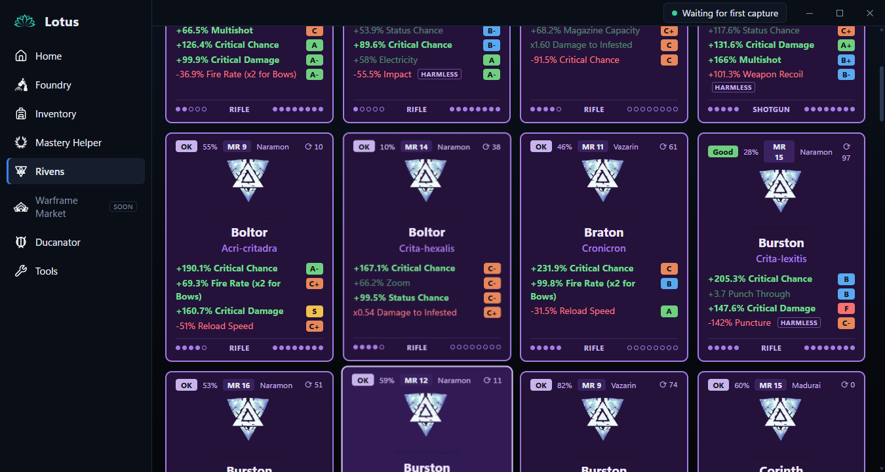
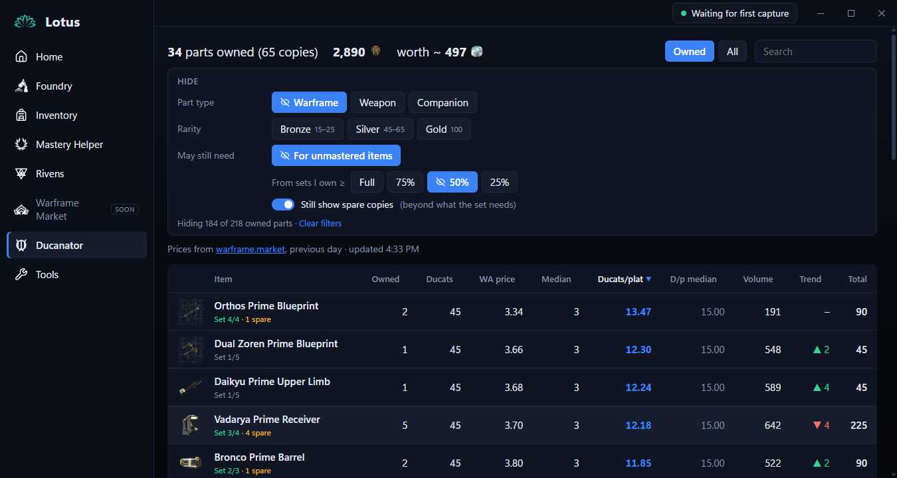
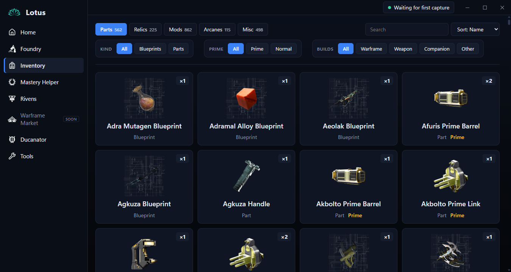

<p align="center"></p>

# Lotus — Warframe companion

> [!WARNING]
> **Use at your own risk.** Lotus is an unofficial, free community tool. It reads the game's log,
> its screen and (read-only) its memory. It never changes the game or sends input to it, but it
> isn't made, approved or supported by Digital Extremes. You're responsible for how you use it.
> Lotus isn't affiliated with Digital Extremes or AlecaFrame.

A Windows desktop companion app for **Warframe**, heavily inspired by
[**AlecaFrame**](https://alecaframe.com). Its layout, page set and overlays follow AlecaFrame's
closely, rebuilt from scratch as a standalone app (no AlecaFrame code, branding or artwork). It
keeps your
inventory up to date on its own, works out what you still need for mastery, prices your items on
warframe.market, grades your rivens, keeps your trade chat messages ready to paste, and draws helper panels over the game for riven cards and
Void Fissure rewards.

Everything runs on your PC. The app never writes to the game, never injects code, never sends
input to the game and never uploads your data.

<p align="center">
  <a href="https://github.com/t-2ddy/Lotus-Warframe-Companion-App/releases/latest"><b>⬇ Download the latest version</b></a>
  · Windows 10 / 11 · about 6 MB · updates itself
</p>

## Screenshots

| | |
|---|---|
|  |  |
| **Home:** your wallet, daily and weekly checklists, arbitrations, fissures and stats | **Foundry:** every masterable item, what's mastered, owned and buildable |
|  |  |
| **Mastery Helper:** progress by category and the fastest ways to gain mastery | **Rivens:** every riven with roll letters, grade and the weapon's ideal stats |
|  |  |
| **Ducanator:** which prime parts to sell to Baro, by ducats per platinum | **Inventory:** parts, relics, mods (with prices), arcanes and more |

## Install

1. Download `Lotus_<version>_x64-setup.exe` from the
   [latest release](https://github.com/t-2ddy/Lotus-Warframe-Companion-App/releases/latest) and
   run it.
2. Windows SmartScreen may say it "protected your PC", because the installer isn't code-signed
   yet. Choose **More info → Run anyway**.
3. Open Lotus, then log in to Warframe. Your inventory is read at login and after each mission.
4. For the in-game overlays, set Warframe to **Borderless** or **Windowed** (Options → Display),
   and turn them on in **Tools**.

Lotus updates itself: when a new version is out, a bar at the top offers **Update and restart**.

## Known limits

- **Windows only:** Windows 10 or 11, 64-bit.
- **English game text only:** the overlays read the riven cards and reward names on screen.
- **Overlays need Borderless or Windowed mode.** Exclusive fullscreen draws over them.
- **Overlay reading is tuned on 16:9 screens at 100% scaling.** Other resolutions and Windows
  display scaling may misread. Please report it if so.
- **Inventory updates at login and mission end**, not live during a mission.
- **No warframe.market page:** Lotus doesn't list or buy items for you. Prices show in Inventory,
  Ducanator and the overlays.

## FAQ

**Is it bannable?**
There's no guarantee either way. Digital Extremes hasn't approved Lotus, and its terms restrict
third-party tools, so use it at your own risk. Here's exactly what Lotus does, so you can judge:

- **The game's log file (`EE.log`) and screen captures.** These are "public" data: you can open
  the log in Notepad and see the same screen yourself. Lotus uses the log to know when you log
  in or finish a mission, and the overlays read the riven card or reward names on screen.
- **Your inventory, read from the game's memory, read-only.** The inventory isn't in the log or on
  screen, so this is the one place Lotus reads from the game process. It only reads: it never
  writes to the game, injects code, hooks it, automates it or sends it input.

Tools that read the game this way are widely used and generally tolerated, but that's not a
promise. If you're not comfortable with the memory read, don't use Lotus.

**Why does Windows warn me when I install it?**
The installer isn't code-signed yet (signing certificates cost money). SmartScreen warns about
any unsigned download it hasn't seen often. The source is public, and the release is built by
GitHub Actions from this repository.

**Where's my data?**
On your PC only, in `%APPDATA%\io.lotus.companion\` (database, caches, settings). Lotus never
uploads your inventory. It only downloads public data: item info, warframe.market prices, the
arbitration schedule and the world state.

**Does it slow the game down?**
It shouldn't. Inventory is read once per login or mission end (a few seconds at most), and the overlays only look
at the screen while a riven card or reward screen is up.

**The overlay misread something. How do I report it?**
Turn on **Tools → Debug logging**, reproduce it, then
[open an issue](https://github.com/t-2ddy/Lotus-Warframe-Companion-App/issues) with your Lotus
version, screen resolution, Windows display scaling and the `overlay.log` (Tools → Open folder).

**How do I uninstall it?**
Windows Settings → Apps → Lotus → Uninstall. To remove your data too, delete
`%APPDATA%\io.lotus.companion` and `%LOCALAPPDATA%\io.lotus.companion`.

---

## Why use it

- **No manual input.** The app watches the game's log and reads your inventory from memory
  whenever it changes: at login and at mission end. Nothing to export, paste or log in to.
- **Mastery at a glance.** Every masterable item with what's mastered, owned, buildable and
  missing, and the fastest ways to gain mastery: the easy ones, those from relics you own, and
  those you can buy with platinum.
- **Prices where you need them.** warframe.market prices for your mods and relic rewards, and
  similar listings for your rivens.
- **Riven help.** Every riven you own with its stats, roll quality, grade and the weapon's ideal
  stats. In game, a panel next to any riven card you open, including other players' rivens and
  new rolls at the reroll screen.
- **Relic picks in game.** At the end of a fissure, a panel under each reward card shows its plat
  and ducat value, whether it's vaulted, and how many you own against what the set needs.
- **Trade chat ready.** Save your Trade and Recruit messages and copy them into the game in one
  click, with item name suggestions (the game's item links), the game's emojis and a counter for
  Trade chat's 180-character limit.
- **Standalone and private.** No Overwolf, no ads, no account. Your history stays in one local
  SQLite file.

> **Account risk:** see [Is it bannable?](#faq) above.

---

## Built on

| Layer | Technology | Used for |
| --- | --- | --- |
| Desktop shell | **Tauri 2** | App window, the transparent overlay window, commands and events between Rust and the UI, global shortcut (Ctrl+Tab) |
| Backend | **Rust** (2021 edition) | Log watching, memory reading, parsing, database, HTTP, screen capture, OCR, all game logic |
| Frontend | **SvelteKit** + **Svelte 5** (runes) + **TypeScript**, built with **Vite** | Every page and the overlay; static build (`adapter-static`) loaded by Tauri |
| Storage | **SQLite** via `rusqlite` (bundled) | Captures, change history, settings, prices, rivens |
| Compression | `zstd` | Raw inventory snapshots |
| HTTP | `ureq` 3 | Every download, through one client with the app's User-Agent |
| Windows APIs | `windows` crate 0.62 | `ReadProcessMemory` / `VirtualQueryEx` (memory), GDI `BitBlt` (screen copy), window lookup, **Windows.Media.Ocr** (built-in text recognition) |
| Search | `memchr` | Fast byte search when scanning memory |
| Charts | Hand-written SVG | Currency charts (no chart library) |
| Data scripts | Python | Building the bundled data files (`scripts/`) |

### Data sources

| Source | What it provides |
| --- | --- |
| Game `EE.log` | Triggers: inventory arrived, mission saved, login name, riven and reroll screens, fissure missions, squad relics, reward screens |
| Game memory | The full inventory JSON (read-only) |
| Game screen | Riven cards, the "Fits in" weapon, relic reward names (Windows OCR) |
| [WFCD warframe-items](https://github.com/WFCD/warframe-items) | Item names, images, build parts, relics and rewards, ducats, vaulted status |
| [Warframe Public Export Plus](https://github.com/calamity-inc/warframe-public-export-plus) | Riven stat values, name parts, weapon dispositions, weapon → riven type |
| [warframe-riven-info](https://github.com/calamity-inc/warframe-riven-info) | Riven formulas and naming (ported to Rust) |
| [warframe.market](https://warframe.market) API v1/v2 | Item prices, riven listings, ducat trade statistics (Ducats tool) |
| Warframe wiki (`Module:Missions/data`, CC BY-SA 3.0) | Star chart nodes and their mastery XP |
| DE world state (`api.warframe.com`) | Live Void Fissures |
| [browse.wf](https://browse.wf) | Arbitration schedule |
| Community riven sheet (44bananas, Xennethkeisere) | Riven grades and each weapon's ideal stats |

---

## How it fits together

```
                 ┌──────────────────────── Warframe (never modified) ───────────────────────┐
                 │   EE.log            process memory            the screen                 │
                 └─────┬──────────────────────┬──────────────────────────┬──────────────────┘
                       │ tail                 │ read-only scan           │ GDI copy + Windows OCR
                       ▼                      ▼                          ▼
   ┌──────────── Rust backend (src-tauri) ─────────────────────────────────────────────────┐
   │  trigger ──► capture ──► translate ──► update (SQLite) ──► "inventory-updated" event  │
   │     │                                                                                 │
   │     └──► overlay controller ◄── screen + OCR ◄── riven / relic logic                  │
   │                                                                                       │
   │  market · riven_market · rivens · riven_data · riven_grades · mastery · worldstate …  │
   │  image cache (wfimg:// protocol) · net (one HTTP client)                              │
   └───────────────┬───────────────────────────────────────────────┬───────────────────────┘
                   │ commands / events                             │ overlay state events
                   ▼                                               ▼
   ┌─── Main window (SvelteKit) ─────────────────┐   ┌─── Overlay window (/overlay) ─────────┐
   │ Home · Foundry · Inventory · Mastery Helper │   │ transparent, always on top,           │
   │ Rivens · Ducanator · Tools                  │   │ click-through until Ctrl+Tab          │
   └─────────────────────────────────────────────┘   └───────────────────────────────────────┘
```

---

## The core pipeline: keeping the inventory current

**Purpose:** always have an up-to-date copy of the account, with a history of what changed,
without the player doing anything.

**Built with:** Rust (`trigger.rs`, `capture/`, `translate/`, `update.rs`, `pipeline.rs`), Win32
memory APIs, `memchr`, `serde_json`, `rusqlite`, `zstd`, `ureq`.

**End to end:**

1. **Trigger** (`trigger.rs`). Tails `%LOCALAPPDATA%\Warframe\EE.log` like `tail -f`, and copes
   with the game recreating the file. It turns known lines into events:
   - `OnInventoryResults, body size=…`: a fresh inventory just arrived (login, after trading).
   - `CommitInventoryChangesCallback - Success`: mission results were saved.
   - `Logged in <name>`: the in-game name (the inventory doesn't contain it).
2. **Capture** (`capture/`). Opens the game with a read-only handle
   (`PROCESS_QUERY_INFORMATION | PROCESS_VM_READ`) and scans its heap for the inventory's
   signature (`{"SubscribedToEmails":`). It cuts out the JSON object without parsing it (string-
   and escape-aware), and keeps the largest copy that:
   - is at least 64 KB
   - contains `"MiscItems"` and `"XPInfo"`
   - parses as JSON

   A scan of about 2.4 GB takes about 0.3 s, which matters because the game frees the text soon
   after. It searches for a signature rather than following pointers, so game updates don't break
   it.
3. **Translate** (`translate/`).
   - Flattens the inventory to one value per item: counts, affinity (`XPInfo`), currencies and
     mod ranks.
   - Finds the account (by its creation time, so several accounts on one PC stay separate).
   - Names every internal `/Lotus/...` path with WFCD data, which is downloaded and cached.
   - Rivens are parsed separately from their `UpgradeFingerprint`.
4. **Update** (`update.rs`).
   - Compares the capture with the previous one and stores the snapshot (zstd raw JSON for the last
     50), the current values and every change in `%APPDATA%\io.lotus.companion\wf-companion.db`.
   - Unchanged captures are skipped. Rivens are replaced on every capture, because rerolls don't
     change any counted value.
5. **Notify.** Emits `inventory-updated`, and every open page reloads its data.

---

## The pages

### Home
- **Purpose:** an at-a-glance dashboard.
- **Shows:**
  - under the name and resources, **Daily** and **Weekly** checklists in drawers. Ticks clear themselves at the
    resets (00:00 UTC daily, Monday 00:00 UTC weekly), and each drawer shows a countdown. Which
    drawers are open is remembered.
  - in-game name, mastery rank, platinum, credits and Endo
  - the next 3 days of arbitrations with their tiers
  - live Void Fissures
  - 30-day charts of platinum, Endo, credits and relics opened per day
- **Tech:** `overview.rs`, `arbitration.rs` (browse.wf schedule, cached 2 weeks), `worldstate.rs`
  (DE's endpoint, at most once a minute while the page is open), `stats.rs` (currency history from
  the change log). The charts are hand-drawn SVG (`CurrencyChart.svelte`). `Checklist.svelte` holds
  the task list and keeps ticks and drawer state in the page's local storage.
- **Pipeline:**
  1. The page calls `get_overview`, `get_arbitrations`, `get_fissures` and
     `get_currency_history`.
  2. The backend joins the stored values with the node data.
  3. The page groups the results by local day and draws them.

### Foundry
- **Purpose:** every masterable item (833) with mastered, owned, vaulted, Subsumed and its build
  parts with owned counts.
- **Filters:** type, mastery, owned, vaulted, ready to build, enough mastery rank, used for
  crafting, favorites, Helminth.
- **Tech:** `foundry.rs` plus the WFCD index.
- **Pipeline:**
  1. Matches the flat inventory against WFCD items and their components.
  2. Works out mastery from `XPInfo` against each item's maximum rank.
  3. The page filters and searches on the client.

### Inventory
- **Purpose:** everything the account holds, in five tabs: Parts, Relics, Mods, Arcanes, Misc.
  Mods have a **Prices** view with warframe.market WTS/WTB.
- **Tech:** `inventory_view.rs`, `market.rs` (warframe.market v2).
- **Pipeline:**
  1. Items are sorted into tabs using WFCD's details.
  2. Rows request prices only when they scroll into view: one request at a time, about 3 a
     second, newest first.
  3. Prices are cached in SQLite for 2 weeks; stale prices show dimmed while they refresh.

### Mastery Helper
- **Purpose:** how close you are to the next rank, and the best ways to get there.
  - **Easy:** items you can build or level now.
  - **From relics:** the chance of getting every missing part by opening each relic you own.
  - **With platinum:** the cheapest missing parts on warframe.market.
- **Tech:** `mastery.rs`, star chart data (`data/nodes.json` from the wiki), intrinsics from
  `PlayerSkills`.
- **Pipeline:** XP from items, star chart nodes (normal and Steel Path), junctions and
  intrinsics are added up against the rank thresholds, then the missing items are ranked by
  effort.

### Rivens
- **Purpose:** every riven you own as a card, showing:
  - weapon and generated name
  - stats at max rank, each with a roll letter (S–F) and bar
  - grade (Great, Good, OK or Bad) and stat perfectness
  - disposition, rank, MR and rerolls

  Clicking a card opens a popup with the weapon's **ideal positives and negatives** (best in
  slot tagged), each stat's worst and best roll, and similar listings on warframe.market.
- **Tech:** `rivens.rs` (formulas ported from warframe-riven-info), `riven_grades.rs` (community
  sheet, cached 2 weeks), `riven_market.rs` (v2 slugs, v1 auction search), `riven_data.rs`
  (riven data refresh).
- **Pipeline:**
  1. Each riven's fingerprint (weapon, rank, 30-bit roll per stat) gives each stat's value:
     base × 1.5 × disposition × 10 × roll × stat-count factor × (rank + 1). Every weapon's
     disposition is 1.2 since DE flattened them in October 2026 (`rivens::DISPOSITION`).
  2. The roll gives the letter, and the stats are checked against the weapon's sheet row for the
     grade and ideal stats.
  3. The popup searches warframe.market from narrow to wide (same stats, then the main positives,
     then any riven for the weapon) until it finds direct sales.

### Ducanator
- **Purpose:** which prime parts to sell to Baro Ki'Teer and which to sell to players. Every
  tradable prime part (or just the ones you own) with its ducats, trade price and **ducats per
  platinum**, best first. A summary shows your parts, total ducats and their plat value.
- **Tech:** `ducanator.rs` (warframe.market's `/v1/tools/ducats`, the data behind their
  [Ducats tool](https://warframe.market/tools/ducats)), `src/routes/ducanator/`.
- **Pipeline:**
  1. Opening the page downloads warframe.market's ducat statistics if the cached copy is over an
     hour old. There's one ~530 KB request through the shared market throttle, and no polling.
  2. Each row (previous day: median and weighted-average price, volume, ranking change) is matched
     to a game path through the cached `/v2/items` list (`id` → `gameRef`). Sets are dropped.
  3. Owned counts come from `MiscItems` and `Recipes` in the latest capture.
  4. Rows are ranked by ducats ÷ weighted-average price, the same ratio warframe.market shows.

### Tools (in-game overlays)
Two switches, both off by default. Both share one transparent, always-on-top, non-focusable
window that ignores the mouse until **Ctrl+Tab**. The game must run in **Borderless** or
**Windowed** mode.

#### Riven overlay
- **Purpose:** a panel next to any riven card you open:
  - from a chat link: your riven or anyone else's
  - at the reroll screen: your current riven on the left, each new roll on the right

  It shows the stats with roll letters, the grade, the weapon's ideal stats and similar
  listings.
- **Tech:**
  - `overlay/mod.rs`: the controller thread
  - `overlay/events.rs`: log lines
  - `overlay/screen.rs`: GDI screen copy, 16:9 card areas, the lilac check
  - `overlay/ocr.rs`: Windows.Media.Ocr, about 20 ms per card
  - `overlay/card.rs`: parsing, label matching, working rivens out backwards
- **Pipeline:**
  1. **Spot the card.** Every 120–250 ms, while the game is in front, the card area is copied and
     checked for lilac riven text. The log's `HudVis` lines prompt an immediate look.
  2. **Read it.** OCR the card (upscaled 2×), then parse the title, stats, MR and rerolls. The
     parser joins wrapped names and labels, and copes with icons read as letters and misread
     digits.
  3. **Settle.** Keep re-reading every 120 ms until two reads agree on a complete card, at most
     about 1 s, so a card caught mid fade-in is corrected straight away.
  4. **Weapon and variant.**
     - The weapon in the title gives the riven type, from the riven data.
     - The **"Fits in"** box at the bottom right is read for the exact variant (Latron vs Latron
       Prime). Variants used to have different dispositions; at a flat 1.2 they no longer
       change the numbers.
     - The log's weapon line is the fallback.
  5. **Identify.**
     - **Your own riven:** matched in your inventory by weapon and name, so the rolls are exact.
     - **Anyone else's, or a new roll:** the rolls are worked out backwards from the shown
       numbers, trying each likely riven type until the numbers fit a rank.
     - **Spliced or unknown traits:** shown as "collecting data" and left ungraded, so the rest of
       the riven still loads.
  6. **Show.** The panel is published to the overlay window. It hides when the card goes,
     detected by the screen check or the log.

#### Relic rewards overlay
- **Purpose:** at the end of a Void Fissure, a panel under each reward card, laid out like
  AlecaFrame's. Each panel shows:
  - plat and ducats
  - vaulted
  - owned against what the set needs
  - the set's parts with your counts
  - crafted or mastered
  - the set's price

  A footer shows your platinum and ducats.
- **Tech:** `overlay/relics.rs` (OCR with word positions, column snapping, fuzzy name matching),
  `market.rs`, the Foundry logic.
- **Pipeline:**
  1. **Mission start (log).** The fissure era is read, then each squad member's relic as it loads.
  2. **Prefetch.** Prices for those relics' rewards are fetched during the mission.
  3. **Reward screen (log).** The names band is copied and OCR'd with word positions, the words
     are grouped into card columns, and each column is matched to the closest reward of the
     squad's relics.
  4. **Panels.** Owned and set data come from the last capture; prices are refreshed live for the
     cards shown.
  5. **Endless fissures.** After each round the squad's new relics are picked up for the next one.
  6. **Close.** On the log's close line, or when the cards leave the screen.

#### Riven data updates
- **Purpose:** keep riven stat values and weapon dispositions current when DE changes them.
  The app currently overrides every listed disposition with the flat 1.2.
- **Tech:** `riven_data.rs` (a Rust port of `scripts/gen_rivens.py`), conditional requests with
  `If-None-Match`.
- **Pipeline:**
  1. **When:** at startup if the last check is over a day old, after a riven that doesn't fit (at
     most hourly), or from **Check for updates** on the Tools page.
  2. **Download:** the three Public Export Plus files, only when changed.
  3. **Use:** rebuild the data, swap it in while the app runs, log what changed, and work out the
     shown riven again. The bundled copy is the offline fallback.

---

## Supporting services

| Service | File | What it does |
| --- | --- | --- |
| Image cache | `images.rs` | Downloads WFCD item images once, only when first shown. At most 4 at a time, with back-off on 429/5xx, and 404s remembered. Serves them to the page over a custom `wfimg://` protocol with a one-year cache header |
| HTTP client | `net.rs` | One `ureq` agent with `User-Agent: Lotus/<version>` and a 30 s timeout |
| Market | `market.rs` | warframe.market v2 item list (`gameRef` = game path, so no name guessing) and top orders. One request at a time, about 3 a second, cached in SQLite |
| Settings | `update.rs` (`settings` table) | Tool switches and other app settings |
| Overlay log | `<app data>/overlay.log` | Only with **Tools → Debug logging** on (off by default): every overlay event, read and show/hide, plus the last image read per card area in `overlay-debug/`. Turning it off deletes both. Cards that couldn't be worked out always go to `riven_misfits.jsonl` (card text only), which triggers a riven data check |

### Local files (`%APPDATA%\io.lotus.companion\`)

| Path | Contents |
| --- | --- |
| `wf-companion.db` | SQLite: snapshots, current values, change history, favorites, account names, settings, rivens, market prices |
| `wfcd/` | WFCD item data |
| `images/` | Item images |
| `market/` | warframe.market item and riven lists, ducat statistics (`ducats.json`) |
| `riven-grades/` | Grading sheet tabs (CSV) |
| `riven-data/` | Public Export Plus files and the rebuilt riven data |
| `arbitrations/`, `nodes/` | Arbitration schedule, star chart data |
| `overlay.log`, `overlay-debug/` | Overlay diagnostics, only while Debug logging is on |
| `riven_misfits.jsonl` | Riven cards that didn't fit the stat data (card text only) |

---

## Building and running

**Needs:** Windows 10 or 11, Node 24 and npm, Rust (MSVC toolchain) with the Visual Studio Build
Tools, and Python 3 only to regenerate bundled data.

```sh
npm install
npm run tauri dev       # run the app (dev builds are optimised: memory scans must be fast)
npm run tauri build     # NSIS installer (Lotus_<version>_x64-setup.exe) in src-tauri/target/release/bundle/nsis
```

**Checks:**

```sh
cd src-tauri && cargo test --lib    # Rust tests (needs `npm run build` first: the app embeds the frontend)
npm run check                       # Svelte / TypeScript check
```

**Releasing a new version:**

```sh
npm run bump -- 0.2.0          # sets the version in package.json, Cargo.toml and the lock files
git commit -am "Release v0.2.0"
git tag v0.2.0 && git push && git push --tags
```

Pushing the tag runs the **Release** workflow (`.github/workflows/release.yml`). It builds the
installer, signs the update, and makes a **draft** GitHub Release with `latest.json`. Publish the
draft to release it. A tag with a `-` (`v0.2.0-beta.1`) is marked pre-release. Installed copies
check `releases/latest/download/latest.json` at start-up and every 6 hours, and show an "Update
and restart" bar. Updates must be signed with the project's updater key (the public half is in
`tauri.conf.json`), so only official releases install.

The **CI** workflow (`.github/workflows/ci.yml`) runs the Svelte check, the frontend build, the
Rust tests and clippy on every push and pull request.

**Regenerating bundled data:**

```sh
python scripts/gen_rivens.py <folder with ExportUpgrades.json, ExportWeapons.json, dict.en.json>
python scripts/gen_nodes.py [module .lua]   # star chart nodes from the wiki (downloads it if no path)
```

---

## Project layout

```
src/                      SvelteKit frontend
  routes/                 one folder per page; overlay/ is the overlay window
  lib/                    shared components (RivenPopup, BestStats, charts, fissures, …)
src-tauri/
  src/
    trigger.rs            EE.log watcher
    capture/              read-only memory scanner
    translate/            inventory parsing, WFCD index, star chart nodes
    update.rs             SQLite store
    pipeline.rs           background thread tying the steps together
    overlay/              the in-game overlay (controller, log events, screen, OCR, cards, relics)
    rivens.rs, riven_*.rs riven views, grades, market listings, data refresh
    foundry.rs, mastery.rs, inventory_view.rs, overview.rs, stats.rs, market.rs, ducanator.rs, …
  data/                   bundled data (rivens.json, nodes.json)
scripts/                  data generators (Python), bump-version.mjs
assets/screenshots/       README screenshots
.github/workflows/        CI and Release (installer, update signing, latest.json)
docs/                     local only (git-ignored): build notes, design plans, and the
                          AlecaFrame reference screenshots the screenshot tests use (those
                          tests skip themselves without them)
```

---

## Ground rules

- **Read-only:** never write game memory, inject code, hook the game or automate input.
- **Polite to shared services:** cache everything, rate-limit requests, send a User-Agent, and
  back off on errors.
- **Local only:** nothing is uploaded; each PC user has their own database.
- **English game text** only for the overlays, for now.

---

## Acknowledgements

- **[AlecaFrame](https://alecaframe.com)**: the app this one is modelled on. Its Foundry,
  Inventory, Mastery Helper, Rivens, riven overlay and relic rewards overlay set the layouts and
  features here. Lotus isn't affiliated with or endorsed by AlecaFrame.
- **[Warframe](https://www.warframe.com)** by **[Digital Extremes](https://www.digitalextremes.com)**:
  the game, its `EE.log`, and the public world state
  ([api.warframe.com](https://api.warframe.com/cdn/worldState.php)) used for Void Fissures.
  Lotus isn't affiliated with or endorsed by Digital Extremes.
- **[Lucide](https://lucide.dev)** (ISC licence): the sidebar icons, via `@lucide/svelte`.
- **[TipsyContent's Warframe checklist](https://tipsycontent.com/warframe/checklist)**: the daily and
  weekly tasks on the Home page.

Data used by the app:

| Source | Used for |
| --- | --- |
| [WFCD warframe-items](https://github.com/WFCD/warframe-items) ([warframestat.us](https://warframestat.us)), images from [cdn.warframestat.us](https://cdn.warframestat.us) | Item names, images, build parts, relics and their rewards, ducats, vaulted status |
| [Warframe Public Export Plus](https://github.com/calamity-inc/warframe-public-export-plus) by calamity-inc, served by [jsDelivr](https://www.jsdelivr.com) | Riven stat values, name parts, weapon dispositions, weapon → riven type |
| [warframe-riven-info](https://github.com/calamity-inc/warframe-riven-info) by calamity-inc | Riven formulas and naming (ported to Rust) |
| [browse.wf](https://browse.wf) | Arbitration schedule, and arbitration tiers rated by the Arbitration Goons |
| [warframe.market](https://warframe.market) | Item prices, riven listings, and the ducat trade statistics behind their [Ducats tool](https://warframe.market/tools/ducats) |
| [Warframe wiki](https://wiki.warframe.com) (`Module:Missions/data`, [CC BY-SA 3.0](https://creativecommons.org/licenses/by-sa/3.0/)) | Star chart nodes and their mastery XP; mastery rank thresholds; the spliced riven trait list |
| ["Good riven rolls" sheet](https://docs.google.com/spreadsheets/d/1zbaeJBuBn44cbVKzJins_E3hTDpnmvOk8heYN-G8yy8) by 44bananas and Xennethkeisere | Riven grades and each weapon's ideal positives and negatives |

Thanks to everyone who maintains these. Please respect each source's terms and rate limits.

## Contributing

Bug reports and pull requests are welcome: see [CONTRIBUTING.md](CONTRIBUTING.md), the
[changelog](CHANGELOG.md) and the [code of conduct](CODE_OF_CONDUCT.md). Please report security
problems privately ([SECURITY.md](SECURITY.md)).

## Licence

Lotus's code is under the [MIT licence](LICENSE). Warframe's artwork in `static/icons/` and the
item images belong to Digital Extremes. They're used under DE's allowance for free,
non-commercial community projects, and aren't covered by the MIT licence. The bundled data keeps
its own terms: `nodes.json` from the Warframe wiki is CC BY-SA 3.0. The full list is in
[NOTICE.md](NOTICE.md).
